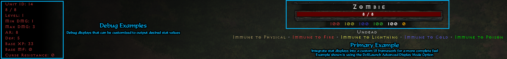

# D2RHUD for D2R 2.4

A HUD and mod extension for Diablo II: Resurrected 2.4, adapted from
[D2RHud](https://github.com/locbones/D2RHud) with support for modded TCP/IP games.
Native features check executable compatibility and may require matching mod data
on the host and clients.

Current HUD release: **1.7.9**.

## Features

- One HUD menu with grouped options, search, a Sanctuary theme, and remembered
  window sizes and pane layouts.
- Editable HUD and quest translations for all 13 game language codes, an offline
  translation editor, and bundled Unicode font support. See
  [translation instructions](translations/README.md).
- Floating damage and DPS, buff icons, item stat ranges, loot filtering, and a
  grail tracker.
  In **On Screen > Damage & DPS > Display**, floating numbers and the DPS counter
  can be shown independently. For DPS only, enable Floating Damage in options,
  turn off **Show floating damage numbers**, and leave **Show DPS Counter** on.
- **Open HUD Menu** in the game's Controls settings, with F12 as the default.
- **Inspect**, enabled by default: click the eye icon above another player, mercenary or allied summon
  while in town to view equipment and backpack contents, including charms,
  in a read-only inventory panel on the left. Both weapon sets are available.
  The panel closes when you leave town. Icon height and optional label size/visibility
  are saved per mod. TCP/IP hosts also need this HUD build.
- Optional in-game widescreen bars removal, D3-style Whirlwind with belt potions,
  persistent summons, and stack splitting/socketing.
- Optional **Spectate players** in **Options > Gameplay** for TCP/IP. Click the
  eye beside a player in the native party menu to watch their live game view,
  including across acts. Switch between a movable/resizable picture-in-picture
  window and full screen; use **Stop spectating** or Escape to exit. The host
  and both players need a compatible HUD. Each player controls whether they
  allow spectators. Your own character stays in the world; spectating does not
  pause or protect it. Picture-in-picture leaves controls outside its window
  available, while full screen blocks new gameplay input.
  Spectate and allowing other players to watch start enabled for new profiles;
  existing saved opt-outs are preserved. Controls allow a 2–60 fps target, 320–3840-pixel
  width (up to 2160 high), quality 30–100, and a 1–128 Mbps video budget
  (16 Mbps by default). Existing settings and PiP layouts are preserved.
  H.264 inter-frame compression replaces independent JPEG images. Frames use a
  separate authenticated TCP connection through the game host; the native game
  channel carries only presence, sharing consent and private session credentials.
  **The host's video TCP port, 6113 by default, must be reachable.** LAN/VPN games
  normally need no port forwarding; Internet hosts may need to forward this
  additional port. Change **Host video TCP port** in Spectate options if needed.
  The host acknowledges video authentication before a connection is marked ready.
  The viewer reports missing video connections, loading, source capture/codec failures
  and stalled frames. Transition diagnostics are saved to `%LOCALAPPDATA%\D2RHUD\spectate.log`
  and included in the local support report; credentials and images are never logged.
  All participating players and the host must use this updated protocol.
  Viewing preferences update while watching. Source aspect ratio/resolution is
  preserved without upscaling; multiple viewers share one encoded source using
  the highest requested width, quality and frame rate. Upload, viewer and shared
  host budgets limit the resulting bitrate. Quality controls a resolution-aware
  H.264 bitrate target, rather than a JPEG quality factor. Achieved frame rate
  depends on CPU/GPU load and the network; 4K/60 is a target, not a guarantee.
  Capture and encoding overlap on background workers; viewer GPU textures are
  reused. Video queues are bounded. Congestion reconnects with a fresh keyframe
  and lowers the relay bitrate ceiling instead of accumulating delayed frames.
  No capture runs without an authorized spectator. Windows' built-in H.264 codec
  is used; a missing Media Foundation installation disables video with an error
  rather than blocking HUD startup. No additional codec DLL is distributed.
  Settings use the existing shared preferences file.
- Mod integrations for cube maps and events, quest tracking, rune storage,
  item visuals, and immunity sunder.
- Random map/event rosters exclude water-dependent frog-demon and watcher/
  tentacle behaviors, including inherited families and linked spawns/minions.
- Temporary RMD-MP Candy Corn migration: legacy `Ev11` items gain quantity 1 on
  character preview, game load or shared-stash page load, with original-save/page backups and an
  on-screen notice. Both softcore and hardcore stash pages are supported.
  Dense legacy tabs reuse failed parsing continuations, and RMD's Halloween
  automagic random property helps resolve old item layouts after current-format
  parsing fails. Valid existing stacks pass through unchanged, with or without it.

Some integrations are specific to RMD-MP. Experimental Workshop features default
to off and need the corresponding mod content.

## 1.7.9 changelog

Changes since 1.7.8:

- Added optional Run Tracker with automatic per-game timing, manual splits, run history, and a movable timer.
- Added run and retained-item charts, area comparisons, value/rarity rankings, CSV exports, and history clearing.
- Added town-only Inspect for allied players, mercenaries, and equipped summons, including inventories and both weapon sets.
- Improved Inspect item artwork, socket details, companion eye placement, and optional label controls.
- Added TCP/IP Spectate with party-menu controls, fullscreen viewing, and movable picture-in-picture.
- Added H.264 spectate video, higher quality/resolution limits, connection recovery, and clearer loading diagnostics.
- Added Dynamic Automap, enabled by default, to move or remove monster CEL markers as monsters move or die.
- Added Merc Seller Unlock, enabled by default, to support hireling sellers defined in hireling.txt, including Act IV.
- Added Merc Icons Fix, enabled by default, to use skilldesc.txt HireableIconCel values in hireling displays.
- Fixed custom hireling purchase and profile selection when different mercenary types share name ranges.
- Added Bulk Cube Outputs to create multiple non-stackable items from output quantity commands while respecting cube space.
- Added Extended Cube Outputs for output D-G, including their level/modifier fields and useitem/useitemX support.
- Added RMD-MP storage-bag merging with combined contents and rejection when a stored stat would overflow.
- Fixed bulk output identification and stopped right-click quantity splitting from affecting equippable stacks such as arrows.
- Added a loot-filter simulator showing how a selected item matches rules and whether the filter hides it.
- Fixed installed-filter dropdown behavior and improved filter-editor previews, searches, and catalog loading.
- Added independent floating damage and DPS display controls, allowing a DPS-only display.
- Fixed Terror Zone rotation getting pinned after manual cycling and corrected transition timer handling.
- Fixed D3-style Whirlwind death handling and automatic gold pickup using the mod's configured radius.
- Added a ten-second loot collection window before completed map events return players to town.
- Added native in-game marketplace integration and improved listing-price persistence, item displays, and transaction feedback.
- Consolidated shared preferences with automatic migration, recovery backups, and safer settings writes.
- Reduced repeated startup, asset-loading, rendering, and act-transition work through caching and modularization.
- Improved session cleanup, background-worker reliability, graphics reset handling, and translated-text validation.
- Added optional performance diagnostics and local support reports for troubleshooting HUD problems.

## Settings and player data

Mod-specific options, themes, buff icons, floating damage and stat ranges stay
in `HUDConfig_<mod>.json`. Shared user preferences now live in one file:
`%LOCALAPPDATA%\D2RHUD\preferences.json`. Its `sections` contain `RunTracker`,
`Language`, `Controls`, `Diagnostics`, `Spectate` and `WindowLayout`.

Existing `RunTracker/settings.json`, `language.json`, `controls.json`,
`diagnostics.json` and `ui-layout.ini` import automatically. Their exact original
contents are retained together in `preferences-migration-backup.json`. An old
file is removed only after the shared document and recovery archive are verified.
Existing shared settings take precedence over leftover legacy files. Malformed
files are kept for repair; unknown settings survive updates. Saves use atomic
replacement and a process writer lock so features cannot overwrite one another.
If migration cannot finish, valid legacy settings remain readable and edits wait
until migration succeeds. New global preferences should use `HudUserConfig::Read`
and `HudUserConfig::Update` with their own section instead of adding sidecar files.

Run histories, quest progress, summon rosters and save-conversion backups remain
separate player data. Translation packs and mod definitions remain editable
content. Marketplace exchange/transaction files keep their existing paths and
schemas for compatibility with the launcher and companion services.

## Run Tracker

Open **Your Adventure > Run Tracker** in the HUD and enable it. Tracking is off
by default. A new run starts for each game; pause, finish or split runs manually
from **Live Run**. Settings include freezing the timer in town/loading screens,
timer formats and milliseconds, and a movable timer overlay with scale,
opacity, optional information rows, position locking and a reset control.

The tracker compares owned inventory, equipment, cube and loaded stash pages.
It records net retained additions and stack quantity increases, rather than
logging ground drops. Discarding, selling or consuming a newly acquired item
removes it from that run's retained list. Transfers between observed containers
do not count twice. Open stash pages to include them; unavailable pages are kept
as unknown, never interpreted as empty. Acquisitions may also come from trades,
crafting or purchases, so retained quantities are not proof of monster drops.

**History** provides period/character/mod filters, favourites, labels, notes and
CSV exports. **Charts** compares run times, retained quantities, rolling averages,
duration distributions, item quality and time spent by area. Recovered partial
snapshots can be included explicitly. Runs save locally under
`%LOCALAPPDATA%\D2RHUD\RunTracker`, every five seconds and when a run finishes.
The most recent observed storage state is used; items on unopened stash pages
cannot be classified. Character and stash save files are never modified.

**Item Analysis** graphs retained item types and qualities as percentages of
entries or stack units. Area rankings compare quantities, active-time rates,
estimated value and pricing coverage. Town areas are optional. The analysis
includes up to the newest 500 matching runs and 100,000 retained entries.

Value rankings use the local marketplace companion's completed-sale cache for
the selected mod and softcore/hardcore mode. Choose a payment currency, sale
window and minimum sample count under **Valuation and rarity settings**.
Currencies stay separate. Comparable medians match base code, quality, named
item, ethereal flag and occupied sockets; rolls and total socket capacity may
differ. Free, bundle and mixed-currency sales are excluded. Stackable sales need
an explicit sold quantity. Older journals remain readable, but incomplete
identity metadata is left unpriced. The cache is read-only and can be refreshed
through the existing marketplace companion.

The rarity ranking uses a selected treasure class as a reference. Its relative
base-selection weights model one weighted draw per table node. They are not
per-kill drop odds: quality/Magic Find, actual Picks, monster levels, player-count
NoDrop and event overrides are not simulated. Unknown, generated, cyclic or
deterministic-pick paths are withheld rather than guessed.

**Settings > History and storage > Clear recorded data...** removes saved Run
Tracker history for all characters and mods after confirmation, including older
runs outside the load limit. Exported CSV files can be removed too. Preferences,
overlay placement, character/stash saves and marketplace data are kept. An active
run restarts with current possessions as its baseline. Pending saves finish before
clearing, so old snapshots cannot reappear. Locked files are reported and remain
available until clearing can be retried.

## Marketplace (RMD-MP 2.4)

The stash footer opens a JSON-native marketplace with **Browse**, **My Items**,
**Offers & Logs**, and **Setup** tabs. Item cards use game artwork and clickable
chat-style property inspection. Prices support exact AND bundles of specific
unique/set items, runes, gold and supported RMD-MP storage-bag resources.

The deployed DreamHost service provides private negotiations/messages, item
history and comparable-sale charts, atomic escrow settlement, exact-price
automatic approval and guarded delivery. A paired PC companion deposits goods
only after D2R closes; the guarded Pandemonium launcher recovers/delivers before
starting the game. Listed goods can trade while their owner's PC is offline.
No networking or save writes run during HUD shutdown.

The same exchange is available at **https://market.d2rmodding.com/**, styled to
match the community website and wiki. It shares player accounts, listings,
offers, logs, history, escrow pricing and setup. The **Marketplace website**
desktop shortcut connects the game player directly. Players can also select
their save folder or use a code from Pandemonium; no website sign-in is needed. Physical stash changes wait for the closed-game
companion. The local simulated third-page seller is retired.

The native deposit/escrow/return cycle has been verified in game, including
property preservation, exactly-once delivery and normal Alt+F4 shutdown.
See [marketplace setup](tools/marketplace/README.md),
[custody and recovery](tools/marketplace/CUSTODY.md), and
[website operation](tools/marketplace/WEB.md).

## Build

Use Visual Studio 2022 with Desktop development with C++, the v143 toolset,
a Windows SDK, and vcpkg MSBuild integration enabled.
Dependencies are declared in [d2rhud/vcpkg.json](d2rhud/vcpkg.json): CascLib,
Detours, MinHook, ImGui (Win32/DX12 bindings), Lua, and sol2. Restore them locally;
installed dependency trees are excluded from Git.

Open [d2rhud.sln](d2rhud.sln) and build **Release / x64**, or run from an x64
Visual Studio developer prompt:

```bat
msbuild d2rhud.sln /m /p:Configuration=Release /p:Platform=x64
```

Build output stays in local output folders. The startup helper source is retained
as a development/test harness; it is no longer part of HUD releases.

## Install and run

With D2R closed, place `d2rhud.dll` in the game installation. The loot filter engine is
provided as [lootfilter.lua](lootfilter.lua); place it in the game working
directory when using loot filtering. Matching mod tables and optional assets
must be supplied by the mod or its launcher.

Launch through the updated Pandemonium app. On Windows, game creation, the
state-table gate, DLL loading and startup diagnostics are integrated into the
app. Linux bundles and manages its Wine bridge internally. Neither platform
requires a separately maintained HUD loader beside the app.

Use `-txt` when compiling mod source tables. Normal BIN-based launches do not
need it. Pandemonium must load the HUD before the game's startup table limits;
the older attach-only injector runs too late for extended tables.
See [startup instructions](d2rhud-injector/STARTUP.md).

Press **F12** to open the HUD, or change **Open HUD Menu** under the game's
**Options > Controls**. Settings save per mod or character as appropriate.
Installation diagnostics are written to
`%LOCALAPPDATA%\D2RHUD\feature-status.txt`.
Startup errors name the failed feature and its reason through the DLL's stable
readiness/diagnostics exports. HUD feature releases replace the DLL; Pandemonium
startup changes ship with the app. Optional Act VI data issues do not block five-act BIN
games, including a saved Act VI preference that cannot activate with those BINs.
Six-act packages and requested TXT preparation still require valid Act VI data.
Act VI validation accepts both
GitHub LF and Windows CRLF line endings while checking file contents.

Quest recipe annotations in `data/D2RHUD/table-metadata.json` do not depend on
the checksum or total size of `cubemain.bin`. Ordinary recipe updates leave
quests available; the matcher checks the quest gates it uses against the
loaded native recipes. Existing quest progress does not need to be reset.
The journal stores one current record per local character under
`%LOCALAPPDATA%\D2RHUD\Quests\RMD-MP`, independent of save checksums,
timestamps, installation paths and recipe-definition hashes. Existing journals
are imported automatically, preserving their furthest completed quests and
observations; the original files remain intact. Old host-held guest progress
is also transferred back when that guest next joins the updated host.
In TCP/IP games the host validates actions and sends updates to the owning
player, whose HUD flushes the local journal and acknowledges the write before
another reward can advance. An exclusive writer lease prevents simultaneous
game instances from overwriting the same character's journal. Both host and
clients need the updated HUD for this synchronization protocol.

## Extended cube conditions

Enable **D2RHUD Options > Items > Extended Cube Conditions** on the host.
The setting saves as `ExtendedCubeConditions` and applies immediately. It defaults
to enabled for RMD-MP and disabled for other mods; saved choices take precedence.
The existing `op`, `param`, and `value` are condition 1. Add these columns to
`cubemain.txt` for conditions 2 and 3:

- `op2`, `param2`, `value2`
- `op3`, `param3`, `value3`
- `oplogic`: `AND` requires every active condition; `OR` requires any of them.
  Blank logic means `AND`. Blank or zero `op` slots are ignored.

For example, `op=3, param=12, value=80` and `op2=4, param2=12, value2=100`
with `oplogic=AND` require a character level from 80 through 100. Operators 1–28 retain the game's own stat scaling,
calendar, item and quest semantics. All item conditions apply to the same
candidate for input 1, preserving the native ingredient and `useitem` selection.
Class, difficulty, expansion, ingredient and journal gates remain mandatory.
Turning this option off restores the original single-condition behavior.

The native recipe BIN layout stays unchanged. Compile normal table edits with
`-txt`; for BIN-only releases, export the updated source annotations with
`python tools/export-table-metadata.py <mod-data-directory>` and distribute
`data/D2RHUD/table-metadata.json` with the BINs. Extra columns are read from
that metadata on normal BIN launches. No whole-table checksum is used to accept
cube annotations. Invalid annotations skip the affected recipe without blocking
startup or unrelated recipes.

Both internal prepare and commit phases run on the server's player/item state.
A TCP/IP client's local option cannot override the host. Native cube request and
inventory/output packets remain unchanged, so single-player's internal
client/server split and TCP/IP use the same enforcement path.

## Additional useitem recipe outputs and inputs

Two host settings are available under **D2RHUD Options > Items**. Both default
to enabled for RMD-MP and disabled for other mods, apply immediately, and save
automatically. Existing saved choices take precedence:

- **Useitem Multiple Outputs** permits `useitem` in output A, B, and C. For
  example, setting all three outputs to `useitem` produces three independent
  copies of input 1, with each output column's modifiers applied separately.
- **Useitem Multiple Inputs** adds `useitem2` through `useitem7`, selecting the
  corresponding recipe input column. `useitem` and `useitem1` select input 1.
  Enable both settings for indexed commands in output B or C.

For example, `output=useitem`, `output b=useitem2`, and `output c=useitem7`
retain inputs 1, 2, and 7 respectively. Other ingredients are consumed normally.
The first reference keeps its original item; repeated references create fresh
item IDs from its saved state, preserving quantity, socket contents, and saved
properties before applying each output's own changes. Native upgrade/base and
item-level calculations use the selected ingredient too.

Compile numbered commands with `-txt` while this updated HUD is loaded. Their
selectors are encoded into `cubemain.bin` for normal BIN launches; no extra
columns or table checksums are required. Existing comma modifiers remain valid,
for example `useitem2,eth`. Combining `useitemN` and `map=...` in the same output
is currently rejected; a separate map output can accompany an indexed output.

Preferences are `MultipleUseitemOutputs` and `MultipleUseitemInputs`. Matching
and creation are enforced on the host in both native prepare and commit phases.
The existing client inventory/output protocol carries the results, including
newly copied items and their socket contents.

## Dynamic Automap

Dynamic Automap is available in **D2RHUD Options → Display** (on by default).
It refreshes discovered monster CEL icons every 100 ms, with an adjustable
50–5000 ms interval. Living monsters move on the automap; dead or unloaded
monsters disappear. The preference and interval use the existing per-mod HUD
configuration. Offline and TCP/IP clients use their own loaded monster data;
this feature adds no network traffic or monster reveal.

Exploration files and static object markers remain intact. For mods that reuse
the same CEL for both objects and monsters, new placements are tracked by origin;
ambiguous cells in an old exploration cache are preserved to avoid hiding objects.

## Merc Seller Unlock

**D2RHUD Options → Gameplay → Merc Seller Unlock** is optional and defaults on.
An explicitly saved off setting is preserved.
When enabled, the loaded `hireling.txt`/`hireling.bin` `Seller` monster ID
authorizes mercenary hiring, including Act IV and custom interactable NPCs.
Reopen the NPC dialog after toggling it. Both the TCP/IP host and hiring client
need the feature enabled and matching mod tables.

Configure the hireling rows for the appropriate `Version`, `Difficulty`, `Act`,
`Class`, names and other normal hireling fields. Existing NPC services and the
four original mercenary sellers' quest requirements are preserved. The native
roster, cost and purchase checks still apply. This option does not spawn NPCs or
create hireling definitions; custom sellers must already be interactable NPCs.
The hiring preview and Buy action resolve name ranges against the selected
seller and current difficulty, so reused mercenary names cannot select another
act's price or mercenary type. The server still verifies the exact purchase price.
Invalid definitions and name ranges exceeding the native 69-name roster are
not unlocked. The setting uses `MercSellerUnlock` in the existing per-mod HUD
configuration; no additional configuration file is needed.

## Merc Icons Fix

**D2RHUD Options → Gameplay → Merc Icons Fix** defaults on; saved off settings
are preserved. It replaces the hireling skill-ID icon list with the frame from
`skilldesc.txt`'s `HireableIconCel`. Each skill uses its `skills.txt` `skilldesc`
link to select the row. Frame zero is valid; blank, negative or invalid values
keep the native icon behavior. The frame belongs to the hireling icon sprite
configured by the panel's `skillIconFilename`, independently of player `IconCel`.

The hiring menu and mercenary inventory panel use the native widget, including
all six slots and controller layouts. Tooltips, required levels, colors and
player icons retain their normal behavior. Reopen the panel after toggling.
This is a client display option and does not require the TCP/IP host to enable it.

For BIN-only distributions, re-export `data/D2RHUD/table-metadata.json` after
compilation with `tools/export-table-metadata.py <mod-data-directory>` (or use
the automatic `-txt` export). It now preserves the source-only hireling icon
column in the existing file. TXT installations read the column directly.

## Source and publishing

- `d2rhud/`: HUD source, embedded fonts/art, and dependency manifest.
- `d2rhud-injector/`: legacy injector and development startup harness source.
- `lootfilter.lua` and `definitions.lua`: loot filter engine and editor definitions.
- `mod/`, `content/`, and `examples/`: mod data, authoring content, and examples.
- `tests/` and `tools/`: regression tests and development/mod-authoring utilities.
- `x64/Release/`: the current DLL and Lua engine for HUD downloads.

Restored dependencies, debug/intermediate builds, release archives, backups,
player data, and local AI/internal documentation are excluded by
[.gitignore](.gitignore). Only `d2rhud.dll` and `lootfilter.lua` are allowed in
`x64/Release`. Keep the published Lua copy in sync with the root source when
preparing an update. Other distribution archives belong in release assets.
See [tests/README.md](tests/README.md) for verification commands.

## Credits

- Original HUD: [locbones/D2RHud](https://github.com/locbones/D2RHud).
- scizzydo for resize logic.
- Killshot for chat and detour structures.
- [dschu012](https://github.com/dschu012) for D2R base configuration.


