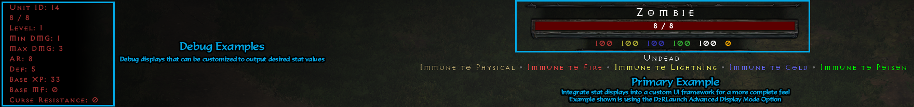

# D2RHUD for D2R 2.4

A HUD and mod extension for Diablo II: Resurrected 2.4, adapted from
[D2RHud](https://github.com/locbones/D2RHud) with support for modded TCP/IP games.
Native features check executable compatibility and may require matching mod data
on the host and clients.

## Features

- One HUD menu with grouped options, search, a Sanctuary theme, and remembered
  window sizes and pane layouts.
- Editable HUD and quest translations for all 13 game language codes, an offline
  translation editor, and bundled Unicode font support. See
  [translation instructions](translations/README.md).
- Floating damage and DPS, buff icons, item stat ranges, loot filtering, and a
  grail tracker.
- **Open HUD Menu** in the game's Controls settings, with F12 as the default.
- Optional in-game widescreen bars removal, D3-style Whirlwind with belt potions,
  persistent summons, and stack splitting/socketing.
- Mod integrations for cube maps and events, quest tracking, rune storage,
  item visuals, and immunity sunder.
- Random map/event rosters exclude water-dependent frog-demon and watcher/
  tentacle behaviors, including inherited families and linked spawns/minions.
- Temporary RMD-MP Candy Corn migration: legacy `Ev11` items gain quantity 1 on
  character preview, game load or shared-stash page load, with original-save/page backups and an
  on-screen notice. Both softcore and hardcore stash pages are supported.
  Dense legacy tabs reuse failed parsing continuations, and RMD's Halloween
  automagic random property helps resolve old item layouts after current-format
  parsing fails. Valid existing stacks pass through unchanged, with or without it.

Some integrations are specific to RMD-MP. Experimental Workshop features default
to off and need the corresponding mod content.

## Build

Use Visual Studio 2022 with Desktop development with C++, the v143 toolset,
a Windows SDK, and vcpkg MSBuild integration enabled.
Dependencies are declared in [d2rhud/vcpkg.json](d2rhud/vcpkg.json): CascLib,
Detours, MinHook, ImGui (Win32/DX12 bindings), Lua, and sol2. Restore them locally;
installed dependency trees are excluded from Git.

Open [d2rhud.sln](d2rhud.sln) and build **Release / x64**, or run from an x64
Visual Studio developer prompt:

```bat
msbuild d2rhud.sln /m /p:Configuration=Release /p:Platform=x64
```

Build output stays in local output folders. The startup helper source is retained
as a development/test harness; it is no longer part of HUD releases.

## Install and run

With D2R closed, place `d2rhud.dll` in the game installation. The loot filter engine is
provided as [lootfilter.lua](lootfilter.lua); place it in the game working
directory when using loot filtering. Matching mod tables and optional assets
must be supplied by the mod or its launcher.

Launch through the updated Pandemonium app. On Windows, game creation, the
state-table gate, DLL loading and startup diagnostics are integrated into the
app. Linux bundles and manages its Wine bridge internally. Neither platform
requires a separately maintained HUD loader beside the app.

Use `-txt` when compiling mod source tables. Normal BIN-based launches do not
need it. Pandemonium must load the HUD before the game's startup table limits;
the older attach-only injector runs too late for extended tables.
See [startup instructions](d2rhud-injector/STARTUP.md).

Press **F12** to open the HUD, or change **Open HUD Menu** under the game's
**Options > Controls**. Settings save per mod or character as appropriate.
Installation diagnostics are written to
`%LOCALAPPDATA%\D2RHUD\feature-status.txt`.
Startup errors name the failed feature and its reason through the DLL's stable
readiness/diagnostics exports. HUD feature releases replace the DLL; Pandemonium
startup changes ship with the app. Optional Act VI data issues do not block five-act BIN
games, including a saved Act VI preference that cannot activate with those BINs.
Six-act packages and requested TXT preparation still require valid Act VI data.
Act VI validation accepts both
GitHub LF and Windows CRLF line endings while checking file contents.

Quest recipe annotations in `data/D2RHUD/table-metadata.json` do not depend on
the checksum or total size of `cubemain.bin`. Ordinary recipe updates leave
quests available; the matcher checks the quest gates it uses against the
loaded native recipes. Existing quest progress does not need to be reset.
The journal stores one current record per local character under
`%LOCALAPPDATA%\D2RHUD\Quests\RMD-MP`, independent of save checksums,
timestamps, installation paths and recipe-definition hashes. Existing journals
are imported automatically, preserving their furthest completed quests and
observations; the original files remain intact. Old host-held guest progress
is also transferred back when that guest next joins the updated host.
In TCP/IP games the host validates actions and sends updates to the owning
player, whose HUD flushes the local journal and acknowledges the write before
another reward can advance. An exclusive writer lease prevents simultaneous
game instances from overwriting the same character's journal. Both host and
clients need the updated HUD for this synchronization protocol.

## Extended cube conditions

Enable **D2RHUD Options > Items > Extended Cube Conditions** on the host.
The setting saves as `ExtendedCubeConditions` and applies immediately. It defaults
to enabled for RMD-MP and disabled for other mods; saved choices take precedence.
The existing `op`, `param`, and `value` are condition 1. Add these columns to
`cubemain.txt` for conditions 2 and 3:

- `op2`, `param2`, `value2`
- `op3`, `param3`, `value3`
- `oplogic`: `AND` requires every active condition; `OR` requires any of them.
  Blank logic means `AND`. Blank or zero `op` slots are ignored.

For example, `op=3, param=12, value=80` and `op2=4, param2=12, value2=100`
with `oplogic=AND` require a character level from 80 through 100. Operators 1–28 retain the game's own stat scaling,
calendar, item and quest semantics. All item conditions apply to the same
candidate for input 1, preserving the native ingredient and `useitem` selection.
Class, difficulty, expansion, ingredient and journal gates remain mandatory.
Turning this option off restores the original single-condition behavior.

The native recipe BIN layout stays unchanged. Compile normal table edits with
`-txt`; for BIN-only releases, export the updated source annotations with
`python tools/export-table-metadata.py <mod-data-directory>` and distribute
`data/D2RHUD/table-metadata.json` with the BINs. Extra columns are read from
that metadata on normal BIN launches. No whole-table checksum is used to accept
cube annotations. Invalid annotations skip the affected recipe without blocking
startup or unrelated recipes.

Both internal prepare and commit phases run on the server's player/item state.
A TCP/IP client's local option cannot override the host. Native cube request and
inventory/output packets remain unchanged, so single-player's internal
client/server split and TCP/IP use the same enforcement path.

## Additional useitem recipe outputs and inputs

Two host settings are available under **D2RHUD Options > Items**. Both default
to enabled for RMD-MP and disabled for other mods, apply immediately, and save
automatically. Existing saved choices take precedence:

- **Useitem Multiple Outputs** permits `useitem` in output A, B, and C. For
  example, setting all three outputs to `useitem` produces three independent
  copies of input 1, with each output column's modifiers applied separately.
- **Useitem Multiple Inputs** adds `useitem2` through `useitem7`, selecting the
  corresponding recipe input column. `useitem` and `useitem1` select input 1.
  Enable both settings for indexed commands in output B or C.

For example, `output=useitem`, `output b=useitem2`, and `output c=useitem7`
retain inputs 1, 2, and 7 respectively. Other ingredients are consumed normally.
The first reference keeps its original item; repeated references create fresh
item IDs from its saved state, preserving quantity, socket contents, and saved
properties before applying each output's own changes. Native upgrade/base and
item-level calculations use the selected ingredient too.

Compile numbered commands with `-txt` while this updated HUD is loaded. Their
selectors are encoded into `cubemain.bin` for normal BIN launches; no extra
columns or table checksums are required. Existing comma modifiers remain valid,
for example `useitem2,eth`. Combining `useitemN` and `map=...` in the same output
is currently rejected; a separate map output can accompany an indexed output.

Preferences are `MultipleUseitemOutputs` and `MultipleUseitemInputs`. Matching
and creation are enforced on the host in both native prepare and commit phases.
The existing client inventory/output protocol carries the results, including
newly copied items and their socket contents.

## Source and publishing

- `d2rhud/`: HUD source, embedded fonts/art, and dependency manifest.
- `d2rhud-injector/`: legacy injector and development startup harness source.
- `lootfilter.lua` and `definitions.lua`: loot filter engine and editor definitions.
- `mod/`, `content/`, and `examples/`: mod data, authoring content, and examples.
- `tests/` and `tools/`: regression tests and development/mod-authoring utilities.
- `x64/Release/`: the current DLL and Lua engine for HUD downloads.

Restored dependencies, debug/intermediate builds, release archives, backups,
player data, and local AI/internal documentation are excluded by
[.gitignore](.gitignore). Only `d2rhud.dll` and `lootfilter.lua` are allowed in
`x64/Release`. Keep the published Lua copy in sync with the root source when
preparing an update. Other distribution archives belong in release assets.
See [tests/README.md](tests/README.md) for verification commands.

## Credits

- Original HUD: [locbones/D2RHud](https://github.com/locbones/D2RHud).
- scizzydo for resize logic.
- Killshot for chat and detour structures.
- [dschu012](https://github.com/dschu012) for D2R base configuration.


